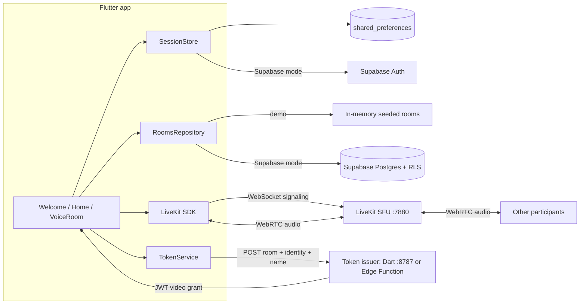

# Nook

A quiet corner to talk. Nook is an audio-only voice room app built with Flutter and LiveKit.

This is the MVP: enter a name, browse open rooms, open your own, and talk. No feed, no followers, no video.

Want to rebuild or extend it? See [`BUILD_PROMPT.md`](BUILD_PROMPT.md) for a complete, copy-pasteable build prompt covering the product spec, stack, architecture, data model, and acceptance criteria.

**Jump to:** [Architecture](#architecture) · [How it works](#how-it-works) · [Quick start](#quick-start) · [Supabase mode](#supabase-mode)

---

## What is in the box

- Flutter app (web, iOS, Android, macOS targets generated)
- LiveKit voice rooms with mute/unmute and speaking indicators
- Demo mode: local room list, no account needed
- Supabase mode: anonymous auth, Postgres-backed room list, RLS in `supabase/schema.sql`
- Local dev token server in Dart (`tool/dev_token_server.dart`)
- Production token endpoint as a Supabase Edge Function (`supabase/functions/livekit-token`)
- Interactive setup script (`scripts/setup.sh`) that checks every tool, asks before installing anything, and stops if you decline

---

## Architecture

Nook runs on two separate networks:

1. **Control plane (HTTPS)** — who you are, what rooms exist, and whether you are allowed to join. This is Supabase (or local demo storage) plus the token issuer.
2. **Media plane (WebRTC)** — the actual audio. LiveKit's SFU receives one audio stream from you and forwards it to everyone else in the room. Audio never passes through Supabase.

The client never holds the LiveKit API secret. It asks a server for a short-lived JWT, then connects with it.

```text
┌───────────────────────────── Flutter app (Chrome now, iOS/Android later) ─────────────────────────────┐
│                                                                                                      │
│   main.dart ──► NookApp ──► WelcomeScreen ──► HomeScreen ──► VoiceRoomScreen                          │
│        │                          │                 │                │                                │
│        │ SessionStore             │ SessionStore    │ RoomsRepository│ TokenService                   │
│        ▼                          ▼                 ▼                ▼                                │
│   shared_preferences        anonymous identity   room list       POST /token                          │
│   name + guest id           (guest-xxxx or       (demo or DB)                                         │
│                              Supabase user id)                                                        │
│                                                    │                │                                 │
│                                                    │                │  livekit_client                  │
│                                                    │                ▼                                 │
│                                                    │        ┌───────────────┐                         │
│                                                    │        │  LiveKit Room │◄── ChangeNotifier       │
│                                                    │        │  (audio only) │    rebuilds UI on events│
│                                                    │        └───────┬───────┘                         │
└────────────────────────────────────────────────────┼────────────────┼─────────────────────────────────┘
                                                     │                │
                        ┌────────────────────────────┼────────────────┼──────────────────────────┐
                        │                            │                │                          │
                        ▼                            ▼                ▼                          ▼
              ┌───────────────────┐      ┌────────────────────┐   WebSocket signaling     WebRTC media
              │ Supabase          │      │ Token issuer       │   ws://127.0.0.1:7880     UDP 7882 / TCP 7881
              │ • Auth (anon)     │      │ • Dart dev server  │            │                (DTLS-SRTP)
              │ • Postgres rooms  │      │   :8787            │            ▼                │
              │ • RLS policies    │      │ • or Edge Function │      ┌──────────────────┐   │
              └───────────────────┘      └─────────┬──────────┘      │ LiveKit SFU      │◄──┘
                                                   │                 │ routes one audio │
                                     signs JWT with│LiveKit secret   │ stream to peers  │
                                                   ▼                 └────────┬─────────┘
                                          LIVEKIT_API_SECRET                  │
                                                                              ▼
                                                                     other participants
                                                                     (other tabs/phones)
```



---

## How it works

### 1. Boot — `lib/main.dart`

- If `SUPABASE_URL` and `SUPABASE_ANON_KEY` were passed as `--dart-define`, Supabase initializes. Otherwise the app skips it entirely.
- `SessionStore.restore()` reads `nook.displayName` and `nook.identity` from `shared_preferences`. If a name exists, you go straight to Home; otherwise Welcome.

### 2. Enter your name — `lib/state/session.dart`

- **Supabase mode:** `signInAnonymously()` creates a real Supabase user. Your `identity` becomes that user's UUID.
- **Demo mode:** generates a persistent `guest-a1b2c3`-style ID and stores it locally.
- No password, no email, no server round-trip in demo mode.

### 3. Home — `lib/data/rooms_repository.dart`

- **Demo:** `DemoRoomsRepository` holds four seeded rooms in memory. Creating a room inserts at the top.
- **Supabase:** `SupabaseRoomsRepository` runs `select` / `insert` against the `rooms` table. RLS ensures only authenticated users can read, and you can only insert rows where `created_by = auth.uid()`.

### 4. Tap Join — `lib/screens/voice_room_screen.dart`

This is the important handshake:

```text
App                          Token issuer                     LiveKit
 │                                │                               │
 │ POST /token                    │                               │
 │ {room, identity, name}         │                               │
 ├───────────────────────────────►│                               │
 │                                │ verify caller (prod only)     │
 │                                │ sign JWT with API secret      │
 │ ◄──────────────────────────────┤ {token, url}                  │
 │                                                               │
 │ connect(ws://127.0.0.1:7880, token)                           │
 ├──────────────────────────────────────────────────────────────►│
 │                                                               │ validate JWT,
 │                                                               │ join room
 │ ◄───────────── signaling + ICE ──────────────────────────────►│
 │                                                               │
 │ publish microphone track ────────────────────────────────────►│
 │ ◄──────────── subscribe to other participants' audio ─────────│
```

- `TokenService.fetch` sends room ID, identity, and display name.
- The **local** issuer (`tool/dev_token_server.dart`) manually builds an HS256 JWT with `package:crypto` using `devkey` / `secret`, matching `livekit-server --dev`.
- The **production** issuer (`supabase/functions/livekit-token/index.ts`) verifies your Supabase bearer token, then uses `livekit-server-sdk` to sign the grant.

The JWT contains a grant, not just an identity:

```json
{
  "video": {
    "room": "<room id>",
    "roomJoin": true,
    "canPublish": true,
    "canSubscribe": true,
    "canPublishData": true
  }
}
```

Because the database room `id` is also the LiveKit room name, everyone who opens the same room row lands in the same LiveKit room.

### 5. Audio path

- The app calls `setMicrophoneEnabled(true)` after connecting.
- LiveKit captures audio and publishes **one** upstream track per user.
- The SFU forwards that track to every other subscriber. This is not peer-to-peer mesh, so your upload cost stays flat as the room grows.
- Media is encrypted with DTLS-SRTP; signaling runs over the WebSocket on `:7880`.

### 6. UI updates

`Room` is a `ChangeNotifier`. LiveKit emits events like `ActiveSpeakersChanged`, `ParticipantConnected`, and `TrackSubscribed`. The listener calls `setState`, so the green speaking ring and participant tiles update without polling.

### 7. Mute / leave

- Mute: `localParticipant.setMicrophoneEnabled(false)` stops publishing; the participant stays in the room.
- Leave: `disconnect()` then `dispose()`, with the listener removed first. The Home screen refreshes on return.

### Demo vs production

| Concern | Demo (local) | Production |
| --- | --- | --- |
| Identity | `guest-xxxx` in `shared_preferences` | Supabase anonymous UUID |
| Rooms | In-memory, seeded | Postgres + RLS |
| Token issuer | Dart `:8787` with `devkey`/`secret` | Supabase Edge Function with secrets |
| Voice server | Local `livekit-server --dev` | LiveKit Cloud (`wss://...`) |
| Secret location | Local dev only | Supabase secrets |
| Cost | $0 | Supabase free tier + LiveKit free tier |

### Security model

- The LiveKit secret exists only in the token issuer. The app receives a scoped, 6-hour JWT.
- Supabase RLS enforces read/insert rules at the database, not in the Flutter code.
- The Edge Function rejects requests without a valid Supabase bearer token.
- Tokens are room-scoped: a token for room A cannot join room B.

---

## Configuration

Defaults work for local demo mode. Override with `--dart-define`:

| Define | Default | Meaning |
| --- | --- | --- |
| `SUPABASE_URL` | empty | Supabase project URL |
| `SUPABASE_ANON_KEY` | empty | Supabase publishable/anon key |
| `LIVEKIT_URL` | `ws://127.0.0.1:7880` | LiveKit websocket URL |
| `TOKEN_ENDPOINT` | `http://127.0.0.1:8787/token` | Token issuer |

```bash
flutter run -d chrome \
  --dart-define=SUPABASE_URL=https://your-project.supabase.co \
  --dart-define=SUPABASE_ANON_KEY=your-publishable-key \
  --dart-define=LIVEKIT_URL=wss://your-livekit-host \
  --dart-define=TOKEN_ENDPOINT=https://your-project.supabase.co/functions/v1/livekit-token
```

If `SUPABASE_URL` and `SUPABASE_ANON_KEY` are set, Nook switches from demo mode to Supabase mode automatically.

---

## Supabase mode

1. Create a Supabase project.
2. Enable **Authentication → Providers → Anonymous sign-ins**.
3. Run `supabase/schema.sql` in the SQL editor.
4. Deploy the token function:

```bash
supabase functions deploy livekit-token
supabase secrets set \
  LIVEKIT_API_KEY=... \
  LIVEKIT_API_SECRET=... \
  LIVEKIT_URL=wss://...
```

5. Run the app with the `--dart-define` values above.

The LiveKit API secret must stay server-side. Never ship it in the Flutter app.

---

## Voice rooms

Rooms are identified by their database ID, which is also the LiveKit room name.
Joining a room:

1. The app asks the token endpoint for a short-lived JWT.
2. It connects to LiveKit with that token.
3. The microphone is enabled after connecting. Mute/unmute is instant.

The token endpoint returns `{ "token": "...", "url": "wss://..." }`.

---

## Local LiveKit server

The binary was compiled from `livekit/livekit` v1.13.11 with Go. To rebuild:

```bash
git clone --depth 1 --branch v1.13.11 https://github.com/livekit/livekit.git
cd livekit
go build -o ~/.local/bin/livekit-server ./cmd/server
```

Start it manually with:

```bash
./scripts/start_livekit.sh
```

---

## iOS / Android

The platform folders are generated, but this machine does not have a full Xcode
install or Android SDK yet.

- iOS: install Xcode from the App Store, then
  `sudo xcode-select -s /Applications/Xcode.app/Contents/Developer`,
  `sudo xcodebuild -runFirstLaunch`, and install CocoaPods. Then
  `flutter run -d ios`.
- Android: install Android Studio and the SDK, then `flutter run -d android`.
- Physical devices cannot reach `127.0.0.1`; point `LIVEKIT_URL` and
  `TOKEN_ENDPOINT` at your laptop's LAN IP or a hosted deployment. Browsers on
  phones also require HTTPS for microphone access, so use LiveKit Cloud or a
  tunnel for device testing.

---

## Project layout

```text
lib/
  app.dart                     app shell and session routing
  main.dart                    Supabase init + session restore
  config/app_config.dart       --dart-define configuration
  data/rooms_repository.dart   demo + Supabase room repositories
  models/nook_room.dart        room model
  screens/                     welcome, home, voice room
  services/token_service.dart  LiveKit token client
  state/session.dart           anonymous identity + display name
  theme/nook_theme.dart        dark lavender theme
  widgets/room_card.dart       room list card
tool/dev_token_server.dart     local JWT issuer for LiveKit dev mode
supabase/schema.sql            rooms table + RLS
supabase/functions/             production token endpoint
scripts/
  setup.sh                     check tools, ask before installing, optional build
  dev.sh                       start the whole local stack
  start_livekit.sh             start LiveKit dev server only
```

---

## Quick start

### 1. Clone

```bash
git clone https://github.com/Asresh/nook.git
cd nook
```

### 2. Check tools (and install if you agree)

```bash
./scripts/setup.sh
```

If the repo is fresh on another machine, make the scripts executable first:

```bash
chmod +x scripts/*.sh
```

The script checks for:

| Tool | Needed for | If missing |
| --- | --- | --- |
| Homebrew | installing anything else | prints install instructions and stops |
| Flutter + Dart | building the app | asks, then `brew install --cask flutter` |
| Google Chrome | running the web app | asks, then `brew install --cask google-chrome` |
| Go | compiling LiveKit server | asks, then `brew install go` |
| `livekit-server` | local voice rooms | asks, then clones + compiles v1.13.11 |
| `git`, `curl`, `lsof` | setup and dev scripts | stops with instructions |

Every install is **opt-in**. If you answer `n`, the script prints the exact
command you need and exits with a non-zero status, so the build stops.

Useful flags:

```bash
./scripts/setup.sh --check    # report missing tools, install nothing
./scripts/setup.sh --yes      # accept all install prompts (CI/automation)
./scripts/setup.sh --build    # install/check, then run flutter build web
./scripts/setup.sh --quiet    # less output (still prompts before installing)
```

### 3. Run everything

```bash
./scripts/dev.sh
```

`dev.sh` calls the tool check first. If a tool is missing and you decline to
install it, the launch stops.

It starts:

| Service | URL |
| --- | --- |
| LiveKit dev server | `ws://127.0.0.1:7880` |
| Token server | `http://127.0.0.1:8787` |
| Flutter app | `http://localhost:5173` |

Then open the app in Chrome, enter a name, and join a room.

### 4. Test with two people

Open a second Chrome window (or an incognito window) at
`http://localhost:5173`, enter a different name, and join the same room. Use
headphones to avoid feedback.

### 5. Verify without a browser

```bash
curl -s http://127.0.0.1:7880
curl -s http://127.0.0.1:8787/health
curl -s -X POST http://127.0.0.1:8787/token \
  -H 'Content-Type: application/json' \
  -d '{"room":"demo-study","identity":"guest-abc123","name":"Aditi"}'
```

---

## Troubleshooting

| Symptom | Fix |
| --- | --- |
| `flutter: command not found` | Run `./scripts/setup.sh`, or open a new terminal after install |
| Chrome does not launch from `flutter run` | Use `flutter run -d web-server --web-port=5173 --web-hostname=127.0.0.1` and open the URL manually |
| "Could not reach the local voice stack" | Start `./scripts/dev.sh`; check `/tmp/nook-livekit.log` and `/tmp/nook-token.log` |
| No audio | Allow microphone permission in Chrome; use headphones; check the mute button |
| "Anonymous sign-ins are disabled" | Supabase → Authentication → Providers → Anonymous |
| Rooms table missing | Run `supabase/schema.sql` in the Supabase SQL editor |
| Port already in use | `lsof -iTCP:7880`, `lsof -iTCP:8787`, `lsof -iTCP:5173` |

---

## Next steps

- Push-to-talk and room-level mute-all
- Participant counts from LiveKit webhooks or room metadata
- Reporting/blocking and room expiry
- LiveKit Cloud for production voice (free tier)
- Push notifications for "someone opened a room"
